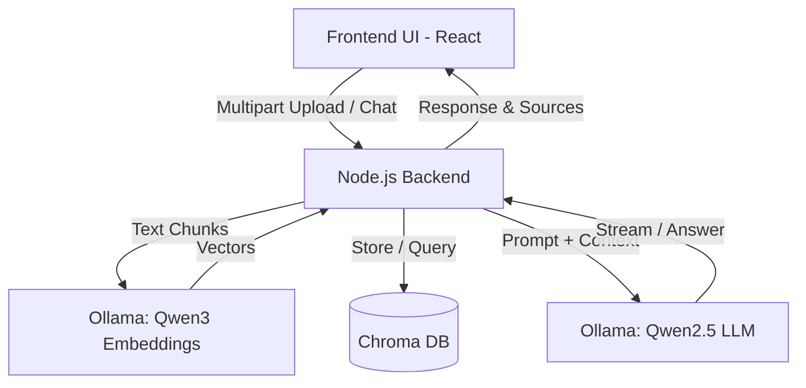

# OpenBook Buddy 📚🤖

**OpenBook Buddy** is a fully self-hosted, private Retrieval-Augmented Generation (RAG) AI assistant designed specifically to help students and professionals tackle open-book tests, research papers, and technical manuals. Powered entirely by local AI models via **Ollama**, **Chroma DB**, **Node.js**, and **React**, your sensitive study materials and textbooks never leave your machine.

---

## 🚀 Key Features

* **100% Private & Self-Hosted:** Runs completely offline using local models (`Qwen3` embeddings and `Qwen2.5` chat generation)—no cloud APIs or OpenAI keys required.
* **Open-Book Test Assistant:** Instantly queries your textbooks, lecture notes, and PDFs (`.pdf`, `.txt`) to surface exact citations and accurate answers.
* **Dynamic Workspace Management:** Upload, initialize, manage, download, or delete documents on the fly.
* **Targeted or Global Retrieval:** Search across your entire study library or restrict queries to specific document IDs.
* **Full Docker Containerization:** Seamless multi-container orchestration using Docker Compose.

---

## 🏗️ Architecture & Tech Stack

| Component | Technology | Role |
| :--- | :--- | :--- |
| **Frontend UI** | React, Vite, Nginx | User workspace, document manager, and chat interface |
| **Backend API** | Node.js, Express, LangChain, Multer | Handles file parsing, chunking, and RAG orchestration |
| **AI & Embeddings** | Ollama (`qwen3-embedding` & `qwen2.5:3b`) | Local vectorization and natural language generation |
| **Vector Database** | Chroma DB (Serverless mode) | Persistent vector storage and semantic similarity search |



---

## 📂 Project Structure

```text
openbook-buddy/
├── .env.example
├── docker-compose.yml
├── README.md
├── backend/
│   ├── Dockerfile
│   ├── package.json
│   └── src/
│       └── server.js
└── frontend/
    ├── Dockerfile
    ├── package.json
    ├── index.html
    └── src/
        ├── main.jsx
        └── App.jsx
```

---

## 🛠️ Step-by-Step Local Setup Guide

### Prerequisites
* **Docker Desktop** installed and running on your system.
* At least **4GB of available RAM** to run the local Ollama models smoothly.

### Step 1: Clone or Set Up the Project
Navigate into your project root folder:
```bash
cd openbook-buddy
```

### Step 2: Configure Environment Variables
Create your local `.env` file from the example configuration:
```bash
cp .env.example .env
```
Ensure your `.env` contains:
```env
PORT=5000
OLLAMA_BASE_URL=http://ollama-service:11434
EMBEDDING_MODEL=qwen3-embedding:0.6b
CHAT_MODEL=qwen2.5:3b
CHROMA_HOST=chromadb
CHROMA_PORT=8000
```

### Step 3: Build and Run with Docker Compose
Execute the following command to build all containers and start the stack:
```bash
docker-compose up --build
```
> *Note: On the first boot, Docker will automatically download Ollama, pull the `qwen3-embedding` and `qwen2.5:3b` models, build the Node.js backend, and set up the React frontend. This may take a few minutes depending on your internet speed.*

### Step 4: Access OpenBook Buddy
Once all services are running:
* **Frontend Web UI:** Open `http://localhost:3000` in your browser.
* **Backend REST API:** `http://localhost:5000`
* **Chroma DB Dashboard:** `http://localhost:8001`

---

## 💡 Usage Workflow
1. **Upload Reference Materials:** In the left sidebar of the UI, upload your exam guides, lecture slides, or textbooks (`.pdf` or `.txt`).
2. **Initialize Workspace:** Click **Upload & Initialize** to chunk and embed documents locally.
3. **Ace Your Test:** Ask questions in the chat box. OpenBook Buddy will reference exact paragraphs from your texts to generate precise, hallucination-free answers!