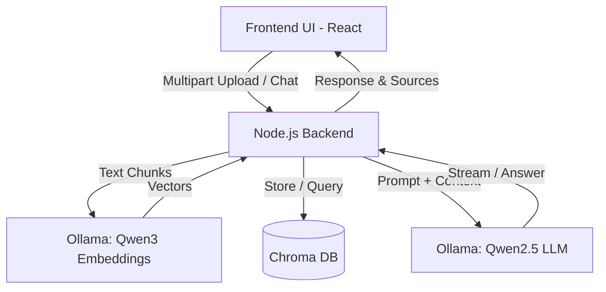

# OpenBook Buddy 📚🤖

**OpenBook Buddy** is a fully self-hosted, private Retrieval-Augmented Generation (RAG) AI assistant designed specifically to help students and professionals tackle open-book tests, research papers, and technical manuals. Powered entirely by local AI models via **Ollama**, **Chroma DB**, **Node.js**, and **React**, your sensitive study materials and textbooks never leave your machine.

---

## 🚀 Key Features

* **100% Private & Self-Hosted:** Runs completely offline using local models (`Qwen3` embeddings and `Qwen2.5` chat generation)—no cloud APIs or OpenAI keys required.
* **Open-Book Test Assistant:** Instantly queries your textbooks, lecture notes, and PDFs (`.pdf`, `.txt`) to surface exact citations and accurate answers.
* **Dynamic Workspace Management:** Upload, initialize, manage, download, or delete documents on the fly.
* **Targeted or Global Retrieval:** Search across your entire study library or restrict queries to specific document IDs.
* **Full Docker Containerization:** Seamless multi-container orchestration using Docker Compose.

---

## 🏗️ Architecture & Tech Stack

| Component | Technology | Role |
| :--- | :--- | :--- |
| **Frontend UI** | React, Vite, Nginx | User workspace, document manager, and chat interface |
| **Backend API** | Node.js, Express, LangChain, Multer | Handles file parsing, chunking, and RAG orchestration |
| **AI & Embeddings** | Ollama (`qwen3-embedding` & `qwen2.5:3b`) | Local vectorization and natural language generation |
| **Vector Database** | Chroma DB (Serverless mode) | Persistent vector storage and semantic similarity search |



---

## 📂 Project Structure

```text
openbook-buddy/
├── .env.example
├── docker-compose.yml
├── README.md
├── backend/
│   ├── Dockerfile
│   ├── package.json
│   └── src/
│       └── server.js
├── frontend/
│   ├── Dockerfile
│   ├── package.json
│   ├── index.html
│   └── src/
│       ├── main.jsx
│       └── App.jsx
└── terraform/
    ├── main.tf
    ├── variables.tf
    ├── outputs.tf
    └── terraform.tfvars.example
```

---

## Run OpenBook Buddy Locally

### Prerequisites

* Docker Desktop (or Docker Engine with the Docker Compose plugin), running.
* At least 4 GB of available memory; more is recommended for running the Ollama models.

From the repository root, create your environment file (`.env.example` contains the defaults):

```bash
cp .env.example .env
```

On Windows PowerShell, use `Copy-Item .env.example .env` instead. `OPENAI_API_KEY` is optional for the current local Ollama chat endpoint.

Build and start all services:

```bash
docker compose up --build
```

The first startup downloads Ollama and the configured models, so it can take a while. When the containers are ready, open:

* **Web app:** [http://localhost:3000](http://localhost:3000)
* **Backend API:** [http://localhost:5000](http://localhost:5000)
* **ChromaDB:** [http://localhost:8001](http://localhost:8001)

Stop the stack with `docker compose down`. Uploaded vectors and Ollama models are stored in Docker volumes and are retained when the containers are stopped.

## Deploy to Linode with Terraform

The Terraform configuration in `terraform/` provisions an Ubuntu Linode and uses cloud-init to install Docker, configure firewall access, and create the Docker Compose and environment files under `/opt/openbook-buddy`. It does **not** copy the application source code to the new server or build/start the containers; those are the remaining deployment steps below.

### Prerequisites

* A Linode account and an API token with permission to create instances.
* Terraform 1.0 or newer installed locally.
* SSH/SCP available locally, and enough Linode memory for Ollama (the Terraform default is `g6-standard-2`).

### 1. Configure and create the Linode

From the repository root, make a private Terraform variables file and provide your Linode token, root password, and region/plan as needed:

```bash
cd terraform
cp terraform.tfvars.example terraform.tfvars
```

Edit `terraform.tfvars`. Treat this file and Terraform state as secrets; do not commit them. The `openai_api_key` value can be empty for the configured Ollama chat flow.

Initialize Terraform, review the plan, then provision the instance:

```bash
terraform init
terraform plan
terraform apply
```

Confirm the apply when prompted. Get the new server's address and UI URL:

```bash
terraform output instance_ip
terraform output ui_url
```

Wait for cloud-init to finish installing Docker before proceeding. You can check by connecting with SSH and running `cloud-init status --wait`.

### 2. Set the frontend API address for this Linode

In `frontend/src/App.jsx`, update the `API_BASE` constant to use the IP returned by Terraform, keeping port `5000` and the `/api` path. For example:

```jsx
const API_BASE = 'http://<LINODE_IP>:5000/api';
```

Replace `<LINODE_IP>` with the actual instance IP. This address is baked into the frontend build, so make this change **before** building/deploying the frontend. If you recreate the Linode with a different IP, update this line and rebuild/redeploy the frontend.

### 3. Copy the application to the server and start it

From the repository root on your local machine, copy the backend and frontend source plus the Compose file to the server (replace `<LINODE_IP>`):

```bash
scp -r backend frontend docker-compose.yml root@<LINODE_IP>:/opt/openbook-buddy/
```

Connect to the server and build/start the stack:

```bash
ssh root@<LINODE_IP>
cd /opt/openbook-buddy
docker compose up --build -d
```

The initial image build and Ollama model downloads can take several minutes. Check service status and logs with `docker compose ps` and `docker compose logs -f`.

### 4. Open the deployed app

Visit the `ui_url` Terraform output, typically `http://<LINODE_IP>:3000`. The Terraform cloud-init firewall allows ports 22, 3000, and 5000. Avoid exposing the backend publicly in a production deployment; use a reverse proxy and HTTPS, and restrict firewall access as appropriate.

### Remove the Linode

When you no longer need the instance, run `terraform destroy` from the `terraform/` directory. This deletes the Linode and its data; download anything you need first.

## Usage

1. Upload PDF or text reference materials from the left sidebar.
2. Click **Upload & Initialize** to split and embed the documents.
3. Ask questions in the chat, optionally filtering retrieval to one document.